  

  
  
  

## About me

I'm a software developer from Lahore, Pakistan, with a BS in Computer Science. I build Android and Flutter apps, React front ends and Python back ends, and I care as much about how a product feels to use as how it works under the hood.

  

- 🔭 Currently building web apps with React and Vite alongside my Android and Flutter work
- 🌱 Learning Clean Architecture, Riverpod, BLoC, Firebase Cloud Functions and CI/CD
- 💼 Open to full-time roles, remote work and freelance projects

## What I do

<table>
  <tr>
    <td width="50%" align="center" valign="top">
       
      
      <h3>Mobile apps</h3>
      
Native Android apps in Java and cross-platform apps in Flutter, backed by Firebase, REST APIs and SQLite.

    </td>
    <td width="50%" align="center" valign="top">
       
      
      <h3>Web apps</h3>
      
Fast, responsive front ends built with React, JavaScript, HTML and CSS.

    </td>
  </tr>
  <tr>
    <td width="50%" align="center" valign="top">
       
      
      <h3>Backend and APIs</h3>
      
Python and FastAPI services, REST API integrations and Firebase back ends.

    </td>
    <td width="50%" align="center" valign="top">
       
      
      <h3>UI/UX design</h3>
      
Clean, consistent interfaces designed around the user, following Material Design and built to work on every screen size.

    </td>
  </tr>
</table>

## Tech stack

| Area | Tools |
| :-- | :-- |
| **Mobile** |  |
| **Web** |  |
| **Backend** |  |
| **Design** |    |
| **Tools** |  |

## Let's connect

I'm always happy to talk about a project, a role or an idea. The quickest way to reach me is by email at [mohsanayan0@gmail.com](mailto:mohsanayan0@gmail.com), or you can find me on [LinkedIn](https://www.linkedin.com/in/muhammad-mohsin-ashraf-178597263/).

  

